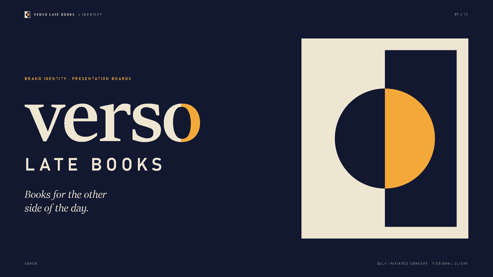

# Verso Late Books: brand identity

1. A self-initiated brand identity concept for a fictional late-night bookshop (open 6 pm to 4 am). There is no real client.
2. One idea carries the whole system: a page split into night and day, with a single disc crossing the gutter. It is knocked out of the dark page like a moon and lit in amber on the light page like a lamp.
3. Ten 1920 x 1080 presentation boards: cover, idea, logo construction and clear space, logo variations, colour, typography, graphic language, two application boards (shopfront, print, social, app icon) and a close.
4. The mark is hand-built SVG on a 100 x 120 grid, checked at 1x raster down to a 16 px floor. Everything else (pattern, mockups, icon) is flat code built from that same disc and grid.
5. Palette is six named colours with usage ratios and computed contrast pairs; type is Sitka plus Bahnschrift. Read [case-study.md](case-study.md) for the rationale, rules and what I would extend.

Boards are in [boards/](boards/).

© 2026 lbishopdev. All rights reserved. View only; see [LICENSE](LICENSE).
