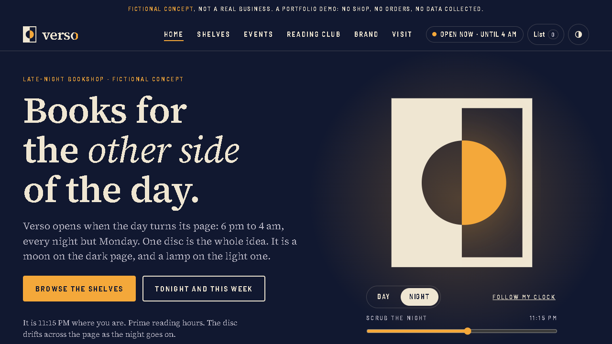

# Verso Late Books: brand identity

**▶ [Open the live site](https://verso.lbishop.app)**  ·  verso.lbishop.app

1. A self-initiated brand identity concept for a fictional late-night bookshop (open 6 pm to 4 am). There is no real client.
2. One idea carries the whole system: a page split into night and day, with a single disc crossing the gutter. It is knocked out of the dark page like a moon and lit in amber on the light page like a lamp.
3. Ten 1920 x 1080 presentation boards: cover, idea, logo construction and clear space, logo variations, colour, typography, graphic language, two application boards (shopfront, print, social, app icon) and a close.
4. The mark is hand-built SVG on a 100 x 120 grid, checked at 1x raster down to a 16 px floor. Everything else (pattern, mockups, icon) is flat code built from that same disc and grid.
5. Palette is six named colours with usage ratios and computed contrast pairs; type is Sitka plus Bahnschrift. Read [case-study.md](case-study.md) for the rationale, rules and what I would extend.

Boards are in [boards/](boards/).

## Live demo

**A fictional late-night bookshop, built as a working website.** One disc is the whole brand: a moon on the dark page, a lamp on the light one, and the site changes with *your* clock.

- Day and night themes that follow your local time, with a hero disc that drifts from dusk to dawn (or scrub it yourself)
- Open-until-4-am status computed live from the shop hours, including closed Monday nights
- A filterable, searchable shelf of 24 invented books with generated typographic covers, plus a reading list saved in your browser
- A late-night events calendar with real, working `.ics` downloads
- A validated Reading Club signup with a membership card (nothing leaves your browser)
- A brand guide with downloadable SVG logos and a zip pack, copy-to-clipboard colours with computed contrast, and type specimens
- Plain HTML, CSS and a little JavaScript. Self-hosted open fonts, no external requests, about 120 to 320 KB per page, responsive from 360 to 1920 px

*Fictional concept, not a real business. Every book, author and event is invented.*

[Open the live demo](https://verso.lbishop.app)

© 2026 lbishopdev. All rights reserved. View only; see [LICENSE](LICENSE).
